# Architecture

## In one paragraph

Weavo is a static, client-only web app: everything runs in the browser tab, there is no
server-side component, no build step, and no bundler. `index.html` loads a fixed list of plain
`<script>` tags in dependency order; each file attaches its exports to a single global namespace,
`window.MP` (e.g. `MP.schema`, `MP.fsAccess`, `MP.ganttView`). Persistence goes straight from the
browser to a folder on disk via the [File System Access
API](https://developer.mozilla.org/en-US/docs/Web/API/File_System_Access_API) — see
[database.md](database.md) for what's actually stored there.

## Why no modules, no framework, no build

The app must run by double-clicking `index.html` — no `npm install`, no dev server. That single
constraint drives most of the structural decisions here:

- **No `<script type="module">`.** ES module scripts are blocked by CORS when the page is opened
  from a `file://` URL. Every file is a classic script using the IIFE pattern
  `(function (MP) { ... })(window.MP = window.MP || {});`.
- **No bundler, no TypeScript.** There's nothing to compile — the files in `js/` are exactly what
  the browser executes.
- **No IndexedDB.** `indexedDB.open()` never resolves under a `file://` origin in Chromium
  (verified empirically, not a missing optimization), so the app can't use it as a local cache.
- **Explicit load order.** Because there are no imports, `index.html`'s `<script>` list *is* the
  dependency graph. A new file must be inserted at the right point in that list, after everything
  it references and before anything that references it.

## Layers

```mermaid
flowchart TB
    subgraph data["js/data — persistence"]
        schema["schema.js\nshapes + factories"]
        fsaccess["fs-access.js\nFile System Access wrapper"]
        legacymig["legacy-migration.js\none-time legacy schema upgrade"]
        repository["repository.js\nload dataset, raw save/backup"]
        savecoord["save-coordinator.js\nreread-before-write conflict check"]
        conflictdiff["conflict-diff.js\nstructural diff for the conflict modal"]
        remotecheck["remote-check.js\nopt-in, focus-triggered remote-change check"]
        slug["slug.js\nfilename slugs"]
    end
    subgraph state["js/state — store"]
        store["store.js\nstate + pub/sub"]
    end
    subgraph model["js/model — pure derivations"]
        weekutils["week-utils.js"]
        overalloc["overallocation.js"]
        validation["validation.js"]
        milestones["milestones.js"]
        msrules["milestone-rules.js"]
        weekshift["week-shift.js"]
    end
    subgraph ui["js/ui — rendering + events"]
        common["common/\nmodal, toast, context-menu, floating-position, toolbar, dataset-header, app-header"]
        crud["crud/\nproject, baseline, task, resource, team"]
        gantt["gantt/\nmain view, cell popover, shift, task/baseline drag&amp;drop (within or across projects), project filter, legend"]
        other["resource-load/, team-resources/, milestones/, weeks/"]
    end
    app["js/app.js — entry point"]

    data --> state
    state --> model
    model --> ui
    data --> ui
    ui --> app
    state --> app
```



1. **`js/data/`** — the only layer that touches disk. `fs-access.js` wraps the browser API with
   no application logic; `legacy-migration.js` runs once per folder connect to upgrade data still
   on an older `schemaVersion` (see [database.md](database.md#legacy-data-migration));
   `repository.js` composes these into whole-dataset load and raw per-file save/backup;
   `save-coordinator.js` is the *only* place a user-triggered write should go through, because it
   adds reread-before-write conflict detection, showing a summary of what changed
   (`conflict-diff.js`, a pure structural diff with no I/O of its own) before the user decides
   whether to overwrite. It also exposes `saveProjects(state, files)` for operations spanning two
   project files (cross-project baseline/task drag): it conflict-checks every file before writing
   any, but provides **no on-disk transaction** — a hard failure mid-write leaves earlier files
   written (see [database.md](database.md#conflict-detection)). `remote-check.js` reuses the same reread primitive for an unrelated,
   opt-in purpose: a focus-triggered (never timer-driven) heads-up that something changed on disk,
   independent of the save path (see [database.md](database.md#conflict-detection)).
2. **`js/state/store.js`** — a state container in the classic sense: one object, `getState`,
   `setState`, `subscribe`. No framework, no virtual DOM, no reducers. `setState` shallow-merges a
   patch and notifies every subscriber synchronously.
3. **`js/model/`** — pure functions over an in-memory dataset: week arithmetic, the
   cross-project overallocation index, non-blocking validation (orphan references, team
   mismatches), baseline-release-milestone derivation for the 2 shared milestone types
   (`milestones.js`, used by the milestones page), the strict-ordering hard-block check shared by
   every milestone write path (`milestone-rules.js`), and the ammissibility check + mutation
   behind shifting an allocation one week back/forward (`week-shift.js`, used by the gantt view's
   shift feature). No I/O, no DOM access, so this layer (plus `js/data/schema.js`) is exactly what
   the [`unit/`](../unit/) Jest suite covers — see "Testing" below.
4. **`js/ui/`** — rendering and event wiring, split by concern rather than by component
   framework conventions: `common/` (modal, toast, context menu, toolbar — including the current
   page's title next to the hamburger button — dataset-header, app-header), `crud/` (one file per
   entity), `gantt/` (the main grid view), plus one folder per secondary view (resource load,
   team/resource management, milestones density report, week-range controls). The gantt and
   resource-load pages share a header (week range, task/project/upcoming-baseline counts, color
   legend) via `common/dataset-header.js`, so the two views always report identical numbers; the
   upcoming-baseline counts come from `MP.milestones.countUpcomingBaselines` (release week ≥ today,
   returns `{ readyForUat, uat }` — the 2 shared milestone types are tracked as independent series
   throughout `milestones.js`) and the milestones page reuses the same header component. Gantt-only
   controls ride on that shared header row as an "extra actions" slot: the two "show completed"
   toggles and the multi-project filter (`gantt/project-filter.js`), all session-only `state.ui`
   flags scoping only the gantt grid — the header's row/project counts follow the project filter
   in the gantt view but not in resource-load/milestones.
5. **`js/app.js`** — the entry point. Subscribes to the store, maps `state.status` to a render
   function, and owns the initial directory-picker flow. Also renders the static brand header
   (`MP.appHeader`) once at startup into `#app-header`, a sibling of `#app` — it sits outside the
   `state.status` render cycle since its content (logo, product name, version, copyright) never
   changes, and is therefore present on every screen, including `unsupported`/`not-connected`.

## Application state machine

`app.js` renders purely as a function of `state.status`:

```mermaid
stateDiagram-v2
    [*] --> init
    init --> unsupported: File System Access API missing
    init --> not-connected: API supported
    not-connected --> loading: user picks a folder
    loading --> ready: dataset loaded
    loading --> error: load failed
    loading --> not-connected: user cancelled the picker
    error --> not-connected: retry
    ready --> ready: any store update (edits, view switch)
    ready --> not-connected: user picks "Change data folder…" from the ☰ menu
```

`state.dataset` (present only in `ready`) holds `{ manifest, teamResources, projects, warnings }`
plus per-file `*Meta` entries used by the save coordinator. `state.ui.currentView` picks which
top-level view renders inside the `ready` state: the gantt grid, the resource-load view, the
milestones density report, or the team/resource management page.

## Render flow

There's no diffing/virtual DOM: every state change clears `#app` and rebuilds the DOM tree for
the current view from scratch (`appEl.innerHTML = ''` followed by a fresh `renderFn(state)`).
This is deliberate — the datasets involved are small (a handful of projects, at most a couple of
hundred weekly cells), so a full rebuild per update is simpler to reason about than incremental
patching, and it means every view function is a pure `state -> DOM node` mapping with no hidden
lifecycle to track.

Event handlers attached during rendering call into `js/ui/crud/*.js`, which mutate the in-memory
dataset, persist the change via `MP.saveCoordinator`, and then call `setState(...)` to trigger a
re-render — a one-way data flow (state → render → user action → mutation → persist → state).

Since the full rebuild replaces every DOM node, anything not part of `state` would otherwise be
lost on each re-render — notably scroll position. `js/app.js`'s `render()` explicitly saves and
restores the scroll offset of the gantt/resource-load grid's scroll container across a rebuild,
and the gantt view separately tracks which cell was last saved so it can be briefly
re-highlighted after the rebuild, so that editing a week cell doesn't visually "jump" the grid
away from the cell just edited.

## Testing

[`unit/`](../unit/) is a dev-only, npm-based Jest suite (own `package.json`, gitignored
`node_modules/`) mirroring `js/`'s folder layout 1:1 (`js/model/week-shift.js` →
`unit/model/week-shift.test.js`), scoped to `js/data/` and `js/model/` — the layers with no I/O
and no DOM, so they run under plain Node with no browser and no mocking of application logic.
[`unit/helpers/load-mp.js`](../unit/helpers/load-mp.js)'s `loadMP(relativePath)` is the shared
fixture: it stubs a bare `global.window`/`global.window.MP` before `require()`-ing a
classic-script IIFE file, which attaches itself to that stub exactly as it would to a real browser
`window` — this is what makes files like `schema.js`/`validation.js` runnable under Node with zero
mocking of application logic, only of the one global they expect to exist. A test needing a
module's own dependencies (e.g. `week-shift.js` needs `week-utils.js` and `milestone-rules.js`
already attached to `MP`) `loadMP`s each one first, in the same order `index.html`'s `<script>`
list uses.

```bash
npm install   # once, installs Jest as a dev dependency
npm test      # runs unit/**/*.test.js
```

**Working practice**: a change to `js/data/schema.js` or anything under `js/model/` should come
with a new or updated test under `unit/` — these are exactly the modules this harness makes cheap
to test, and they carry the app's sharpest edge-case logic (milestone ordering, week-shift
collision detection, orphan/mismatch detection). This is a norm, not an enforced CI gate.

`js/ui/` has no equivalent convention (no jsdom in this stack) — verify UI changes by actually
running the app (open `index.html`) rather than reaching for Jest. The exception is `js/ui/crud/`
logic that is *near-pure* (mutates plain dataset objects, then delegates persistence/rendering to
stubbable `MP.saveCoordinator`/`MP.store`): `unit/ui/baseline-move.test.js` and
`unit/ui/task-move.test.js` cover `moveBaselineToPosition`/`moveTaskToPosition` — including the
cross-project two-file save and its rollback — by `loadMP`-ing the crud file with those globals
stubbed. Anything touching the DOM stays out of Jest. To check headlessly for
console errors after a change, run headless Chrome with an explicit `--user-data-dir` and a
**native Windows path** (a Git-Bash style `/tmp/...` path resolves incorrectly):

```bash
chrome.exe --headless=new --disable-gpu --no-sandbox --user-data-dir=<writable dir> --enable-logging=stderr --v=1 --virtual-time-budget=3000 --dump-dom "file:///<absolute Windows path>"
```

then grep the stderr output for `CONSOLE` to see `console.log`/errors from the page. For a
one-off, throwaway check that doesn't belong in `unit/`, the same `loadMP` trick works directly in
a scratch script — load the plain-script modules into a Node sandbox with a stubbed `window` and
call their exported `MP.*` functions directly, optionally against JSON read from
[sample-data/](../sample-data/).

[spike-fsa/index.html](../spike-fsa/index.html) is a standalone throwaway page (not part of the
app) for manually checking whether File System Access API directory permissions survive a
browser/PC restart on a real network/OneDrive folder.

## Hard-won lessons

A few non-obvious decisions and bugs worth knowing before touching the same code again:

- **Shift feature is deliberately not part of the cell popover's save path.** An early version put
  the ◀/▶ shift arrows inside `cell-popover.js` and reopened the popover (reseeded at the shifted
  position) after each shift. Closing that reopened popover without touching anything still ran
  the popover's own autosave-on-close bulk path, silently overwriting the whole selected range with
  the anchor week's single value — destroying the very per-cell heterogeneity the shift had just
  preserved. The fix is architectural: `js/model/week-shift.js`'s mutation never goes through
  `MP.schema.createWeekEntry`/the popover's save path, so the two can never overwrite each other's
  data, even now that both panels can be visible at once. Their DOM/save logic stays split for that
  reason, but their on-screen geometry is coordinated: `js/ui/common/floating-position.js`'s
  `positionStack()` treats both as one block that flips above/below the cell based on real measured
  space, so they stack without overlapping instead of each independently guessing where the other
  landed (the original failure mode near the top/bottom edge of a scrolled page).
- **A `position: sticky` element's CSS `width` — not its grid track size — governs what actually
  paints.** `resource-load-view.js` once reused the gantt page's `col-1`/`col-2` CSS classes for
  its own frozen initials/name columns; its `grid-template-columns` declared different track
  widths than what those classes render at, which doesn't error, it just silently misaligns —
  produced a ~20px overlap with the first week column, hidden behind the sticky column's
  background. Found by rendering the grid in isolation in headless Chrome and reading
  `getBoundingClientRect()` on every cell, not from the CSS/JS alone. Fixed by giving that view its
  own dedicated column classes (`rl-col-initials`, `rl-col-name`) sized to match its own grid.
  The gantt view's three frozen-column widths now avoid this trap structurally instead of by
  convention: the inline `grid.style.gridTemplateColumns` in `gantt-view.js` and the
  `.gantt-cell.col-1/col-2/col-3` `width`/cumulative-`left` rules in `styles.css` both read three
  CSS custom properties (`--mp-col1-w`/`--mp-col2-w`/`--mp-col3-w`, literal pixel values kept only
  as `var()` fallbacks) instead of duplicating literal widths — one value, read in two places, so
  they can't drift apart. `js/ui/gantt/column-resize.js` (`MP.colResize`, the Excel-style
  mouse-drag column resize on the three header cells) is the single writer of those properties,
  via `gridEl.style.setProperty(...)` **on the `.gantt-grid` element itself** — CSS custom
  properties inherit down the DOM subtree they're set on, so this keeps the effect scoped to that
  one grid instance and never leaks into Milestones' separate grid element. Chosen widths persist
  in `localStorage` (key `mp.ganttColWidths`) as a per-browser UI preference, not project data (so
  never written to the shared JSON files); `renderGanttView` re-reads and re-applies them on
  *every* render (default or previously resized) since a full DOM rebuild would otherwise reset
  them to the CSS fallback — same "reapply after rebuild" pattern as `scrollLeft`/`lastEdited`
  below. `col-1` and `ms-col-baseline` are **still also reused by the Milestones grid**
  (`milestones-view.js` has its own `gridTemplateColumns` string and a totals mini-grid) — it never
  sets the `--mp-col*-w` properties itself, so it always renders at the literal `var()` fallback
  widths and is unaffected by resizing the gantt view, by design (only `col-2` was already
  gantt-private; Milestones swapped in `ms-col-baseline` precisely to decouple it — resizing didn't
  change that split, it just changed how the gantt side of it is expressed).
- **Single-scrollbar page layout.** The outer document (`html body`) never scrolls
  (`overflow: hidden`); the gantt/resource-load/milestones pages are flex columns stretched to
  fill the viewport, with everything except the grid pinned `flex: 0 0 auto` so only the grid's own
  scroll container absorbs remaining space and produces the page's one scrollbar, both axes.
- **Full DOM rebuild loses anything not in `state`.** Since every `setState` clears and rebuilds
  `#app` from scratch (see "Render flow" above), `js/app.js`'s `render()` explicitly saves/restores
  the grid's `scrollLeft`/`scrollTop` across a rebuild, and the gantt view tracks the last-edited
  cell outside `state` so it can be briefly re-highlighted after the rebuild — otherwise every edit
  would snap the grid back to the top-left and visually lose the cell just changed.
- **Cross-project drag writes two files with no on-disk transaction.** Dragging a baseline or task
  between two *different* projects mutates two `projects/*.json` files. `MP.saveCoordinator.saveProjects`
  runs the reread-before-write conflict check on **every** file before writing **any** of them, so a
  cancelled conflict prompt means nothing was written and `MP.baselineCrud.moveBaselineToPosition` /
  `MP.taskCrud.moveTaskToPosition` can roll the in-memory move back exactly. But a hard write failure
  in the second phase still leaves the first file written — there's no journaling or rollback for
  that. The write order is fixed as `[destination, source]` so that failure duplicates the object
  (visible, hand-fixable on the source's next save) instead of losing it. A plain sequential loop of
  `saveProject` was rejected precisely because it can write file 1 and then have the user cancel the
  conflict prompt on file 2, stranding a one-sided write. There is no undo.

## Where to look for a given change

- **New UI affordance on an existing view** → the relevant file under `js/ui/`.
- **New field on the data shape** → start in `js/data/schema.js` (factories + validity helpers),
  thread through `js/data/repository.js`, then the `js/ui/` renderer(s) that display it.
- **Anything that writes a file in response to a user action** → must go through
  `MP.saveCoordinator`, never call `MP.repository.save*` directly, or conflict detection is
  silently skipped. An action touching **two** project files at once (cross-project baseline/task
  drag) → `MP.saveCoordinator.saveProjects(state, files)`, and handle its `false` return (a
  cancelled conflict prompt) by rolling the in-memory change back.
- **Reordering / moving a baseline or task via drag** → `js/ui/gantt/baseline-drag.js` /
  `task-drag.js` (gesture + drop-target wiring in `gantt-row.js`), calling
  `MP.baselineCrud.moveBaselineToPosition` / `MP.taskCrud.moveTaskToPosition` (same-file vs.
  cross-file branch inside each).
- **Resizing a gantt column** (Project/Team, Baseline, Task) → `js/ui/gantt/column-resize.js`
  (`MP.colResize`: mouse gesture, `localStorage` persistence, module-level transient drag state —
  same "never touch `state`/`setState` mid-gesture" convention as the drag modules above, but
  plain `mousedown`/`mousemove` instead of HTML5 Drag&Drop, which doesn't suit a resize handle)
  plus the `--mp-col1-w`/`-col2-w`/`-col3-w` CSS custom properties it writes (see "Hard-won
  lessons" above for why those, not literal widths, are now the single source of truth).
- **A new kind of cross-cutting warning** (like orphan references) → `js/model/validation.js`,
  surfaced by the gantt view's warnings panel and per-cell badges.
- **A gantt view-scoped display toggle/filter** (like "show completed" or the project filter) →
  a session-only field on `state.ui` (`store.js`), a control built in `gantt-view.js`'s
  `toolbarActions` (passed into `common/dataset-header.js`), and — if it changes which rows
  render — a parameter on `MP.ganttView.buildRows`. The project filter also has its own
  `js/ui/gantt/project-filter.js` (a dropdown checkbox panel that batches its edits and only
  calls `setState` on close, so the full re-render doesn't fight the open panel). A row-hiding
  filter interacts with reorder gestures: baseline/task drag needs no change (a hidden row is
  simply never a drop target, and index math runs on the raw arrays), but `MP.projectCrud.moveProject`
  skips over hidden neighbours so `↑/↓` isn't a no-op under a filter.
